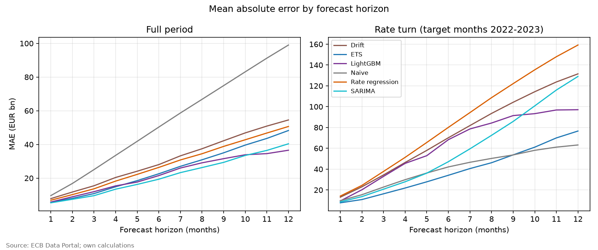
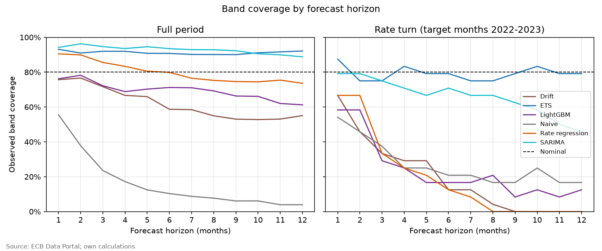
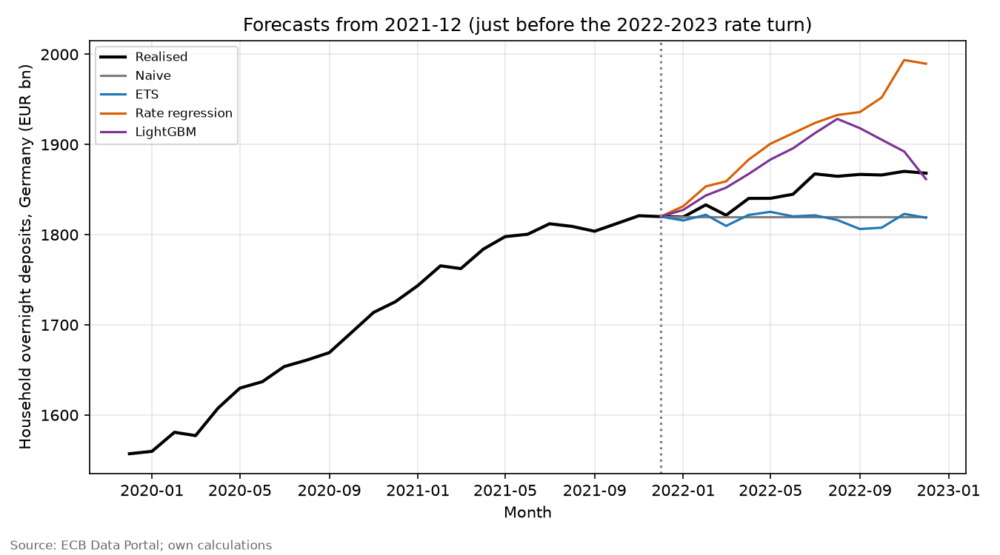
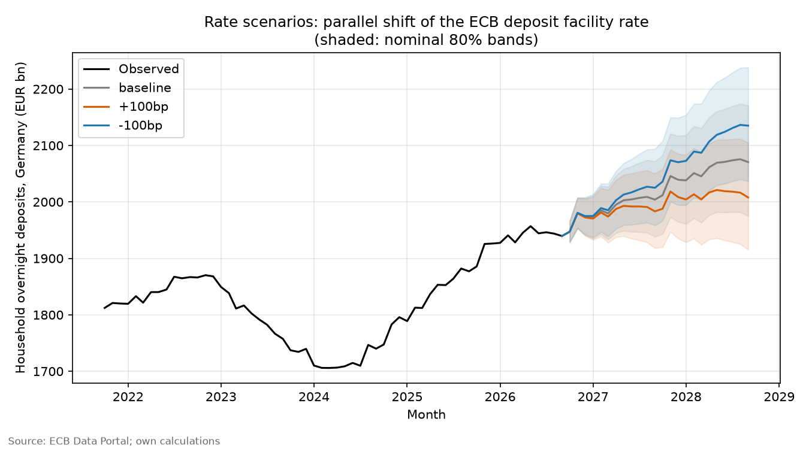
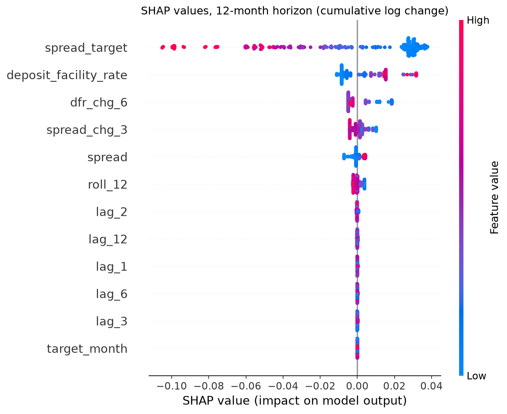

# deposit-forecasting

Comparing forecasting models for household overnight deposits on public ECB data, judged on
**accuracy**, **transparency** and **effort**. Six models (naive, drift, exponential smoothing,
SARIMA, a rate regression and gradient boosting) are scored in a rolling-origin backtest over
1 to 12 months, with a stress test on the 2022-2023 rate turn, and the rate regression drives
+/-100 bp scenarios. The [notebook](notebooks/results.ipynb) walks through everything; design
decisions and answers to the central questions are in [`docs/methodology.md`](docs/methodology.md).

All data is public and comes from the ECB Data Portal. The only exception is a small fictional
deposit book in `synthetic.py`, always labelled synthetic, that demonstrates planned outflows.

## Data

Series are downloaded from the keyless ECB Data Portal API
(`https://data-api.ecb.europa.eu/service/data/<DATASET>/<KEY>?format=csvdata`).

| Column | Series key | Meaning | Unit |
|---|---|---|---|
| `deposits` | [`BSI.M.DE.N.A.L21.A.1.U2.2250.Z01.E`](https://data.ecb.europa.eu/data/datasets/BSI/BSI.M.DE.N.A.L21.A.1.U2.2250.Z01.E) | Overnight deposits of households and NPISH at German MFIs, end of month, not seasonally adjusted | EUR bn (API: EUR m) |
| `overnight_rate` | [`MIR.M.DE.B.L21.A.R.A.2250.EUR.N`](https://data.ecb.europa.eu/data/datasets/MIR/MIR.M.DE.B.L21.A.R.A.2250.EUR.N) | Bank rate on household overnight deposits, new business | % p.a. |
| `time_deposit_rate` | [`MIR.M.DE.B.L22.F.R.A.2250.EUR.N`](https://data.ecb.europa.eu/data/datasets/MIR/MIR.M.DE.B.L22.F.R.A.2250.EUR.N) | Bank rate on household deposits with agreed maturity up to 1 year, new business | % p.a. |
| `deposit_facility_rate` | [`FM.B.U2.EUR.4F.KR.DFR.LEV`](https://data.ecb.europa.eu/data/datasets/FM/FM.B.U2.EUR.4F.KR.DFR.LEV) | ECB deposit facility rate, level (published on change dates) | % p.a. |

`load_panel()` builds a monthly panel (`PeriodIndex`, 2003-01 to the last month with target and
both bank rates) with these columns plus `spread` (time deposit rate minus overnight rate, in
percentage points). The latest deposits value is provisional; its status is available as
`panel.attrs["last_deposit_status"]`. Design decisions are in
[`docs/methodology.md`](docs/methodology.md).

## Reproduce

```bash
uv sync                                  # install dependencies
uv run deposit-forecasting-data          # load the panel from the committed cache, print a summary
uv run deposit-forecasting-data --refresh  # download again and overwrite data/raw/
uv run deposit-forecasting-backtest      # rolling-origin backtest of all models (--out DIR writes CSVs)
uv run deposit-forecasting-backtest --out results  # regenerate the committed result tables
uv run deposit-forecasting-figures       # result figures in docs/figures/ from results/
uv run deposit-forecasting-scenarios     # +/-100 bp rate scenarios, saves docs/figures/rate_scenarios.png
uv run deposit-forecasting-explain       # SHAP summary plots of the gradient-boosting model (--out DIR)
uv run jupyter execute --inplace notebooks/results.ipynb  # re-run the notebook (writes no figures)
uv run pytest                            # offline tests
```

## Status

- [x] Data
- [x] Baselines
- [x] Rolling-origin backtest
- [x] Exponential smoothing and SARIMA
- [x] Rate regression and scenarios
- [x] Gradient boosting
- [x] Results and recommendation

## Results

Rolling-origin backtest, one forecast origin per month from 2010-12, horizons 1 to 12 months,
expanding window. Driver models (rate regression, LightGBM) receive the realised rates of the
forecast months, so their scores show how well rates are translated into deposits, not how well
rates are guessed. Each cell shows the MAE in EUR bn and, in brackets, the share of realised
values inside the nominal 80 % band. The tables in `results/` hold all horizons and MAPE;
they were produced with `uv run deposit-forecasting-backtest --out results` on the panel ending
2026-09 (the latest deposits value is provisional).

**All target months** (189 forecasts at horizon 1, 178 at horizon 12)

| Model | h=1 | h=3 | h=6 | h=12 |
|---|---|---|---|---|
| Naive | 9.6 (56 %) | 25.1 (24 %) | 50.3 (10 %) | 99.0 (4 %) |
| Drift | 7.8 (76 %) | 15.5 (72 %) | 28.0 (59 %) | 54.5 (55 %) |
| ETS | 5.7 (93 %) | 10.8 (92 %) | 22.6 (91 %) | 48.3 (92 %) |
| SARIMA | **5.3** (94 %) | **9.6** (95 %) | **19.4** (93 %) | 40.4 (89 %) |
| Rate regression | 6.9 (90 %) | 13.7 (86 %) | 26.4 (80 %) | 50.7 (74 %) |
| LightGBM | 5.8 (76 %) | 12.0 (72 %) | 21.5 (71 %) | **36.6** (61 %) |

**Rate turn** (target months 2022-2023, 24 forecasts per horizon)

| Model | h=1 | h=3 | h=6 | h=12 |
|---|---|---|---|---|
| Naive | 9.7 (54 %) | 22.8 (38 %) | 42.1 (21 %) | **63.2** (17 %) |
| Drift | 13.1 (67 %) | 34.4 (33 %) | 70.1 (12 %) | 131.5 (0 %) |
| ETS | **7.7** (88 %) | **16.3** (75 %) | **34.1** (79 %) | 76.6 (79 %) |
| SARIMA | 8.5 (79 %) | 20.8 (75 %) | 47.1 (71 %) | 129.0 (46 %) |
| Rate regression | 14.2 (67 %) | 37.8 (33 %) | 80.1 (12 %) | 159.2 (0 %) |
| LightGBM | 9.5 (58 %) | 33.0 (29 %) | 68.3 (17 %) | 97.1 (12 %) |







Over all months every model beats the naive forecast clearly, and the seasonal statistical
models (SARIMA, ETS) are the most accurate up to six months with well-calibrated bands, while
LightGBM wins at 12 months but with bands that are too narrow (61 % against 80 %). The 2022-2023
turn changes the picture: deposits grew only about 2.6 % in 2022, peaked in late 2022 and fell in 2023
while rates rose, and the trend-following drift and the rate regression overshoot, with MAE two to three times that of the naive forecast
at 12 months and bands that almost never contain the outcome. ETS, which damps its trend, copes
best up to eight months; at 12 months the naive forecast is the most accurate. The bands of
every other model fall far below the nominal level at long horizons, while the ETS bands hold near it (79 % at 12 months). The turn has only 24 forecasts per horizon, so
differences between models there are indicative.

Rate scenarios (parallel +/-100 bp shift of the ECB deposit facility rate against unchanged
rates, 24 months) from the rate regression:



The gradient-boosting model relies mainly on the spread of the target month and the deposit
facility rate at the 12-month horizon (SHAP summary on the full history):



## Model comparison

Accuracy summarises both segments (qualitative ratings of MAE across the six models). Transparency asks
whether each driver can be read and explained. Effort covers implementation, data, maintenance
and compute.

| Model | Accuracy: all months | Accuracy: rate turn | Transparency | Effort | Rate scenarios |
|---|---|---|---|---|---|
| Naive | Poor, worst at every horizon | Good: best at 12 months | Full: one number | Minimal | No |
| Drift | Fair | Poor, trend overshoots | Full: one parameter | Minimal | No |
| ETS | Good, bands well calibrated | Best up to 8 months | Medium: states and seasonal factors | Low, fast fit | No |
| SARIMA | Best up to 10 months | Fair, collapses at long horizons | Low to medium: orders are hard to explain | Low to medium, orders chosen once | No |
| Rate regression | Fair, bands slightly narrow | Poor, same failure as drift | High: every effect is a coefficient | Low, needs rate data | Yes |
| LightGBM | Good at long horizons, bands too narrow | Poor to fair | Low: SHAP explains the fit, not causes | High: features, per-horizon models, tuning risk | Only with a feature-based rate path |

## Recommendation

- **Primary model: the rate regression.** It is the only model that answers "what happens to
  deposits if rates move", every effect is a readable coefficient, and it is reasonably
  accurate in normal times (better than drift and naive at every horizon, with bands close to
  nominal at short horizons). It is not the most accurate model, and it fails at the rate turn,
  so it should be used for explanation and scenarios rather than as an unchecked point forecast.
- **Accuracy challenger: a statistical model (ETS or SARIMA), optionally LightGBM.** SARIMA and
  ETS are cheap and lead the full-period scores; ETS also held up best in the turn. LightGBM is
  the most accurate at 12 months but needs more effort, has too-narrow bands and is harder to
  explain.
- **Benchmark and monitoring: the naive forecast plus band calibration checks.** No model
  handled the 2022-2023 turn well, and at 12 months the naive forecast beat all of them there.
  A simple robust benchmark shows when a model is no longer adding value, and observed band
  coverage should be tracked against the nominal level instead of trusting the stated bands.

The numbers do not argue for dropping the transparent model: its weakness at a structural break
is shared by the other trend-based models, while its explanatory value is unique.

## Limitations

- Aggregate data for Germany: no customer segments, no individual deals, no product-level
  behaviour.
- Ex-post conditional evaluation for driver models: they see the realised rates of the forecast
  months, so their scores are better than a real-time forecast, which needs a rate forecast or a
  scenario path.
- One structural break in the sample: the 2022-2023 rate turn is the only stress test, with 24
  forecasts per horizon, and the models have little history of comparable regimes.
- The panel is the latest data vintage, so revisions to past values are not reproduced, and the
  last deposits value is provisional.
- The planned-outflow demo uses a small **synthetic** deposit book of a fictional bank; it
  illustrates the logic and proves nothing about real accuracy.

## Data source

Data: European Central Bank, ECB Data Portal (<https://data.ecb.europa.eu>). Reuse follows the
ECB's terms for statistical data.
